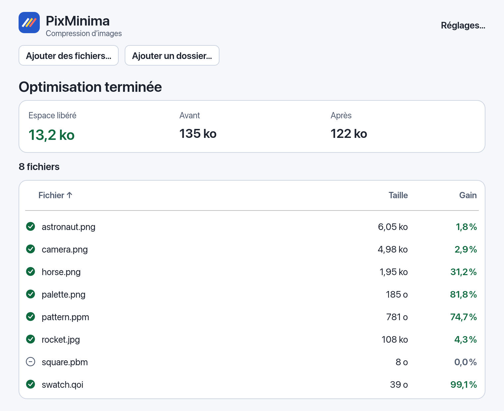

# PixMinima

[English](README.md) · [Présentation du logiciel](https://alejandrosml.github.io/PixMinima/) · [Télécharger pour Mac](https://github.com/alejandrosml/PixMinima/releases) · [Comparatif](docs/comparison.fr.md)

PixMinima est un logiciel libre de compression d’images pour les Mac Apple Silicon sous macOS 27 Golden Gate ou ultérieur. Glisse des images ou un dossier dans la fenêtre et clique sur **Optimiser et remplacer**. Chaque image garde son nom et son emplacement. Par défaut, PixMinima vérifie que l’image et ses métadonnées prises en charge sont préservées avant de la remplacer par un fichier plus petit. Les colonnes **Taille** et **Gain** indiquent la taille finale et le pourcentage économisé pour chaque image.



## Utiliser l’application

Ouvre l’image disque et glisse **PixMinima** dans **Applications**. Tu peux déposer des fichiers depuis le Finder ou les choisir avec **⌘O**. **⌘↩** lance le traitement. Par défaut, l’application remplace les originaux sans créer de sauvegarde. Dans les réglages, tu peux aussi choisir de créer des copies ou de conserver une sauvegarde avant le remplacement. Dans ce dernier cas, les originaux sont rangés à côté des images, dans le dossier masqué `.pixminima-originals`. La restauration protège les fichiers que tu as retouchés depuis.

La fenêtre s’affiche dans la langue du système. Tu peux choisir le français, l’anglais ou l’espagnol dans les réglages. Le site propose 13 langues et variantes et suit les préférences du navigateur. Au premier lancement, le niveau **Maximum** est sélectionné. Trois niveaux règlent le temps consacré à la recherche. **Maximum** reprend les essais du mode approfondi et explore davantage d’encodages PNG et JPEG. Si aucun essai ne fait mieux que l’original, le gain affiché est de 0 %.

La case **Autoriser la compression avec perte** est désactivée par défaut. Si tu l’actives, PixMinima peut aussi essayer une réduction de palette ou de précision sur certains PNG, JPEG, GIF et WebP. Le résultat doit respecter les contrôles de qualité propres au format et peser moins que la meilleure version sans perte disponible. Le remplacement sans sauvegarde est définitif. [Méthodes et limites](docs/formats.md#optional-lossy-compression)

Sur Mac, les mises à jour stables sont recherchées automatiquement. Tu peux régler la recherche et le téléchargement dans les réglages, ou lancer une vérification manuelle. PixMinima vérifie le fichier téléchargé et la signature Apple de l’éditeur. Tu choisis quand installer et relancer l’application, une fois le traitement des images terminé. [Fonctionnement des mises à jour](docs/updates.md)

## Formats et performances

PixMinima traite les PNG et APNG, JPEG, GIF, WebP, TIFF et BMP, ainsi que des composites Photoshop, des images OpenEXR, des icônes, des fichiers vectoriels et d’autres formats. Il préserve notamment les profils colorimétriques, les métadonnées prises en charge, les paramètres d’animation et les couleurs sous les pixels transparents. Pour les HEIC, HEIF, AVIF et JPEG XL, il peut alléger le conteneur en gardant intact le flux image. La limite d’entrée est de 256 Mio par fichier. [Détail par format](docs/formats.md)

Le processeur traite plusieurs fichiers en parallèle. Sur un Mac compatible, le mode automatique mesure si Metal accélère le choix des filtres PNG pour les images du lot. Le processeur assure notamment la compression DEFLATE, la lecture et l’écriture. [Mesures sur M1 Max](bench/metal/) · [Protocole et résultats détaillés](bench/)

## Compiler et utiliser la ligne de commande

La compilation utilise Rust stable. La création du paquet Mac nécessite les outils de développement Apple et le SDK macOS 27.

```sh
cargo build --release --locked -p pixminima
cargo test --locked --workspace
cargo run --release --locked -p pixminima-desktop
./scripts/package-macos.sh
```

L’application distribuée inclut la commande `PixMinima.app/Contents/Helpers/pixminima`. Appelée seule avec des chemins, elle mesure le gain possible. Pour écrire sur le disque, indique le mode souhaité.

```sh
pixminima --measure --maximum photo.png
pixminima --thorough --output-dir copies images/
pixminima --overwrite images/
pixminima --in-place photo.png
pixminima --restore photo.png
pixminima --json --measure images/
pixminima --maximum --lossy --output-dir copies-avec-perte exemples/
```

`--overwrite` remplace les originaux sans sauvegarde. `--in-place` garde une sauvegarde pour la restauration. Les sorties séparées protègent les fichiers déjà présents. Pour compiler la commande avec Metal, ajoute `--features metal`.

## Code et licence

Les modules Rust de PixMinima interdisent le code `unsafe`. Les dépendances de compression et de vérification de la version standard passent le même contrôle à la compilation. Les bibliothèques graphiques et les accès au système s’appuient sur des interfaces natives. Une variante facultative permet aussi d’archiver un JPEG en JPEG XL et de reconstruire l’original à l’octet près. [Périmètre du contrôle Rust](docs/safety.md) · [Variante d’archivage](crates/archive-jxl/README.md)

PixMinima est distribué sous licence GNU GPL version 3 ou ultérieure. Les licences des bibliothèques et des polices accompagnent le logiciel. [Licence](LICENSE) · [Mentions des tiers](docs/THIRD-PARTY.txt)

PixMinima est créé par **Alejandro San Martin Lamas**. [Profil GitHub](https://github.com/alejandrosml)
