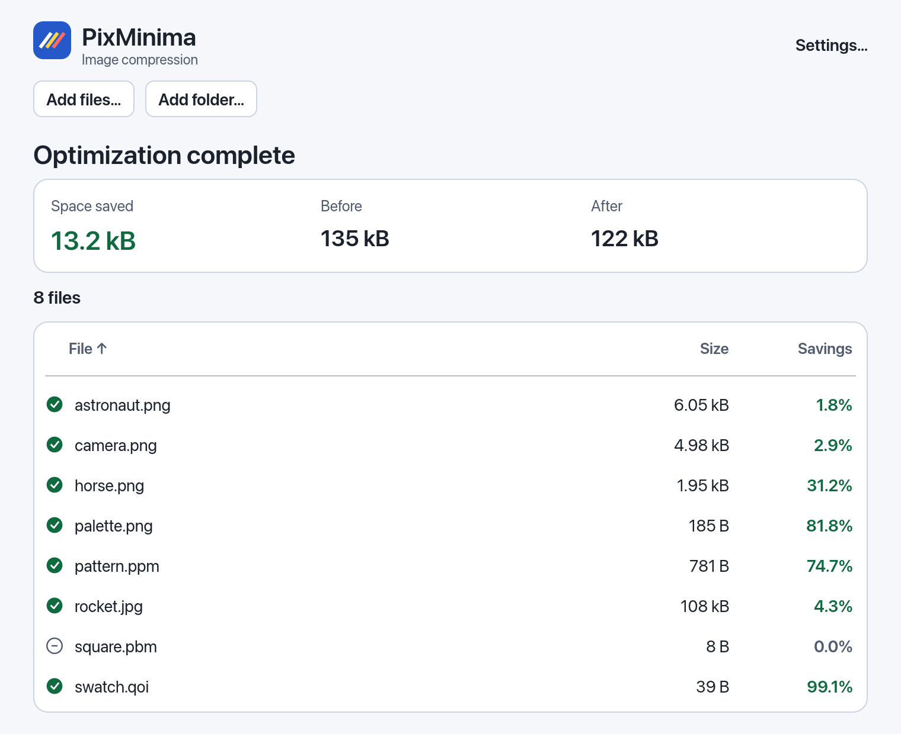

# PixMinima

[Français](README.fr.md) · [Project website](https://alejandrosml.github.io/PixMinima/) · [Download for Mac](https://github.com/alejandrosml/PixMinima/releases) · [Comparison](docs/comparison.en.md)

PixMinima is a free, local image optimizer for Apple silicon Macs running macOS 27 Golden Gate or later. Drop images or folders into the window and choose **Optimize and replace**. Each original stays in its folder under the same name. By default PixMinima verifies that the image and its supported metadata have been preserved before replacing it with a smaller file. The table shows the final **Size** and the percentage under **Savings** for every file.



## Use the Mac app

Open the disk image and drag **PixMinima** into **Applications**. Open files with **⌘O** or drag them from Finder. **⌘↩** starts the batch. The default replaces the selected originals without keeping backups. Settings also offer separate copies or replacement with a restorable backup. The backup option keeps the originals in a hidden `.pixminima-originals` directory next to the images. A restore checks for edits before replacing an optimized file.

The app follows the system language. Choose English, French or Spanish in Settings to override it. The website follows browser language preferences and supports 13 languages and regional variants. The app starts at **Maximum** effort. Its three compression levels control how long the encoder searches. **Maximum** includes the thorough search and tries extra PNG and JPEG encodings. A file that already compresses well may finish with 0% saved.

**Allow lossy compression** is off by default. Turn it on to try palette or precision reduction on eligible PNG, JPEG, GIF and WebP files. The result must pass format-specific quality checks and be smaller than the best lossless result found. Replacing an original without a backup is permanent. [Methods and limits](docs/formats.md#optional-lossy-compression)

On macOS, PixMinima automatically checks for stable releases. Settings let you change how it checks and downloads updates or run a check by hand. PixMinima verifies the download and its Apple Developer ID signature. You choose when to install and relaunch after a batch finishes. [How Mac updates work](docs/updates.md)

## Images and performance

The engine handles PNG and APNG, JPEG, GIF, WebP, TIFF, BMP, Photoshop composites, OpenEXR, icon families, vector and layered-image containers, and several additional raster formats. It retains supported metadata, color profiles, animation controls and fully transparent pixel colors. HEIC, HEIF, AVIF and JPEG XL have container optimizations that retain the encoded image stream. The standard build accepts individual files up to 256 MiB. [Format-by-format details](docs/formats.md)

Batches use parallel CPU workers. On a compatible Mac, automatic mode measures whether Metal accelerates PNG row-filter selection on the images arriving in that session. File I/O, other codecs and the DEFLATE search still use the CPU. [M1 Max measurements](bench/metal/) · [Comparative methods and raw data](bench/)

## Build and command line

Build with stable Rust. The native Mac package requires Apple's developer tools and the macOS 27 SDK. These commands run from the repository root.

```sh
cargo build --release --locked -p pixminima
cargo test --locked --workspace
cargo run --release --locked -p pixminima-desktop
./scripts/package-macos.sh
```

The distribution includes its CLI inside `PixMinima.app/Contents/Helpers/pixminima`. A bare command-line invocation measures potential savings. Choose a write mode explicitly in scripts.

```sh
pixminima --measure --maximum photo.png
pixminima --thorough --output-dir smaller images/
pixminima --overwrite images/
pixminima --in-place photo.png
pixminima --restore photo.png
pixminima --json --measure images/
pixminima --maximum --lossy --output-dir lossy-copies samples/
```

`--overwrite` replaces originals without a backup. `--in-place` keeps one for restoration. Separate outputs refuse existing paths. For a Metal-enabled CLI build, pass `--features metal`. Developers signing their own package can set `CODESIGN_IDENTITY` and `NOTARY_PROFILE`.

## Source and license

PixMinima's Rust crates forbid unsafe code. The locked compression and verification dependency graph in the standard build also passes a compiler audit for unsafe code. The graphical and filesystem libraries include native platform bindings. An optional source build adds reversible JPEG-to-JPEG-XL archival. [Safety boundary](docs/safety.md) · [Optional archive feature](crates/archive-jxl/README.md)

PixMinima is released under the GNU GPL version 3 or later. The library and font notices accompany the application. [License](LICENSE) · [Third-party notices](docs/THIRD-PARTY.txt)

PixMinima is made by **Alejandro San Martin Lamas**. [GitHub profile](https://github.com/alejandrosml)
